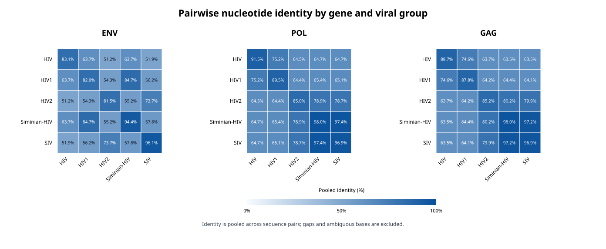

# HIV/SIV conservation comparison

This project collects HIV and simian immunodeficiency virus (SIV) genome sequences to investigate how they are conserved. Downloaded data is stored in Scratch 10 on an HPC. This project was completed for the class Supercomputing for Science class at William & Mary. 

### How does nucleotide sequence diversity differ among the gag, pol, and env genes across HIV-1, HIV-2, and SIV, and which genomic regions exhibit the greatest evolutionary conservation?

## Computing Requirement 
Although many of these scripts seem simple a high performance computer is necessary for this to run! Many hours of compute time were used on the bora node of the W&M hpc. This project was competed on the bora node that has 2x Intel Xeon E5-2640 processors, 20 cores per node, 20 nodes, 64 GB of memory, on the 10 GbE/FDR IB network, and was deployed in 2017. 

## Current workflow

The scripts expect the data directories to already be created. Run the 00_setup_file_directory.sh to create them before running the download script. 

```bash
bash scripts/00_setup_file_directory.sh
```

### 1. Download genome data

Submit the batch script:

```bash
sbatch scripts/01_download_data.sbatch
```

It uses NCBI `datasets` to download complete genomes for the configured taxon IDs (11676, 57667, 12721, 35274, 11709, and SIV). The HIV downloads are saved as `HIV1.zip`, `Siminian-HIV.zip`, `HIV.zip`, `HIV3.zip`, and `HIV2.zip`; the SIV download is saved as `SIV.zip`. The ZIP files are saved in their corresponding HIV or SIV Scratch 10 directories. The script's Slurm output and error files are written to the directory from which the job was submitted.

### 2. Unpack the NCBI datasets

After the download job finishes successfully, run:

```bash
bash scripts/02_unpack_data.sh
```

This extracts each archive into its own subdirectory under the matching HIV or SIV directory.

### 3. Remove the ZIP archives

After verifying that the extracted data is present and usable, run:

```bash
bash scripts/03_clean_up_data_folder.sh
```

This permanently removes the downloaded ZIP archives; the extracted directories are retained.

### 4. Create the Conda environment

Run:

```bash
bash scripts/04_create_conda_env.sh
```

The script loads Miniforge and creates or updates the `hiv-comp-env` environment from `hiv-comp-env.yml`, which installs Biopython for reading annotated GenBank files. To activate the environment in a later shell, initialize Conda and activate it:

```bash
module load miniforge3
eval "$(conda shell.bash hook)"
conda activate hiv-comp-env
```

The setup script activates the environment and verifies that Biopython imports successfully after creating or updating it, then deactivates the environment. The pairwise-identity plotting helper uses only Python's standard library, so it does not require an additional plotting package.

### 5. Compare env, pol, and gag (run once)

After all six extracted datasets are present and step 4 has created `hiv-comp-env`, submit the comparison job from the project directory:

```bash
sbatch scripts/05_compare.sbatch
```

Wait for this job to finish successfully before proceeding to step 6. `05_compare.sbatch` calls `05_compare.sh`, which runs extraction, alignment, and the pairwise identity summary. Do not submit the comparison again if you have already run it successfully and `results/region_pairwise_identity.csv` exists. If working inside an allocated compute node instead of submitting a job, you can run `bash scripts/05_compare.sh`.

The script extracts annotated `env`, `pol`, and `gag` CDS features from each dataset's `.gbff` files, aligns each region separately with MAFFT, and compares every dataset-group pair. The regions are extracted from the CDS product name: 'envelope', 'gp120', or 'gp160' map to env; 'polymerase' or 'reverse transcriptase' map to pol; and 'core protein' or 'pr55' map to gag. Unmatched regions and fusion areas are skipped. The comparison includes within-group pairs as well as between-group pairs. It requires the extracted directories `HIV/HIV`, `HIV/HIV1`, `HIV/HIV2`, `HIV/HIV3`, `HIV/Siminian-HIV`, and `SIV/SIV` under `~/scr10/data_project`; it stops with an error if a dataset directory or its genome files are missing. MAFFT aligns each region, and `06b_summarize_comparison.py` summarizes the alignments.

Outputs are written to the project `results/` directory:

- `env.fasta`, `pol.fasta`, `gag.fasta`: extracted nucleotide CDS sequences, labeled with their dataset group.
- `env.aln.fasta`, `pol.aln.fasta`, `gag.aln.fasta`: MAFFT alignments.
- `region_sequence_counts.csv`: extracted sequence counts for each region and dataset group.
- `region_pairwise_identity.csv`: sequence-pair counts, alignment lengths, callable and identical site totals, and pooled percent identity for each region and group pair.

Identity is calculated over alignment columns where both sequences have an unambiguous nucleotide (`A`, `C`, `G`, or `T`); gaps and ambiguous bases are excluded. The reported percent identity is pooled across all sequence pairs in each group comparison, not an unweighted average of per-sequence identities. Rows with no available sequence pairs or no callable sites have a blank identity value. Check the extraction warnings and sequence-count table before interpreting comparisons, since datasets may lack a CDS annotation for a region.

### 6. Run pairwise identity comparisons and create the heatmap

This step requires step 4 (the `hiv-comp-env` environment) and successful completion of step 5 (the existing `results/region_pairwise_identity.csv`). If you have already completed both, proceed directly to the plot; do not rerun either step. From the project directory, create the heatmap from the existing CSV:

```bash
bash scripts/07_pairwise_identity.sh
```

If you prefer to submit the plotting step as a small Slurm job, submit the wrapper from the project directory:

```bash
sbatch scripts/07_pairwise_identity.sbatch
```

The script loads Miniforge, initializes Conda in its current shell, activates `hiv-comp-env`, runs `07_plot_pairwise_identity.py` on the existing CSV, and deactivates the environment. The heatmap covers within-group and between-group comparisons for HIV, HIV1, HIV2, HIV3, Siminian-HIV, and SIV.

The plotting step writes `results/region_pairwise_identity_heatmap.svg`, with one heatmap panel per gene. It does not modify the comparison CSVs. Inspect the sequence counts and comparison CSV alongside the heatmap; identity values are pooled over callable nucleotide sites, with gaps and ambiguous bases excluded.



## Personal Reflection 
What started as a whim during the add/drop period at the beginning of the semester has somehow turned into this project! Before this class I didn't even really know what a HPC was, how to fully use my terminal to contorl my computer, wildcards in bash scripts and anything about Git/Github. I had taken Intro to Programming and Data Structures but the hpc seemed very far away. This class and this project has really pushed my limits on how I am using a computer, and even AI tools. If you told me 3 years ago when I entered college that I would be using a 'high performance computer' or even the amount of coding that I am doing I dont think I would have believed you. 